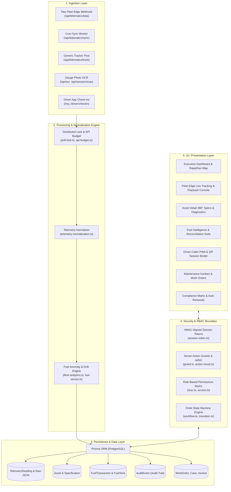
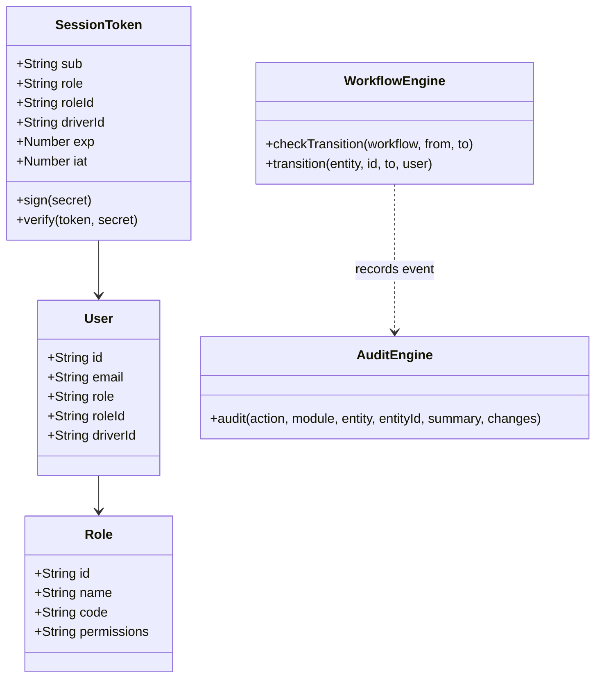
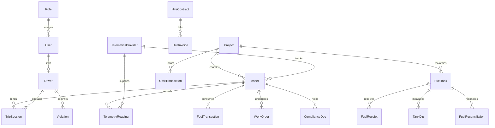

# FleetView ERP — Complete System Architecture & Feature Reference

A unified, end-to-end technical reference and functional inventory of the **FleetView ERP** codebase. This document outlines every subsystem, data model, telematics ingestion pipeline, analytics engine, workflow state machine, user interface view, and API endpoint across the entire repository.

---

## 1. High-Level System Architecture

---

## 2. Telematics & Sensor Ingestion Pipeline

FleetView ERP integrates multi-vendor telematics, OEM direct streams, driver mobile telemetry, and computer vision fuel gauge readings into a unified model.

### 2.1 Ingestion Sources

1. **Tata Fleet Edge Dedicated Push Receiver (`/api/telematics/tata`)**:
   - Accepts real-time webhook push deliveries matching Tata's webhook specification.
   - Matches vehicles by registration number, vehicle code, chassis number (`chassisNo`), or provider-assigned `deviceId`.
   - Supports single-event telemetry objects and multi-vehicle telemetry batches.
   - Handles challenge verification responses for webhook endpoint handshakes without credentials.
2. **Tata Fleet Edge Scheduled Pull Sync (`/api/telematics/sync` & `instrumentation.ts`)**:
   - Vercel cron scheduled poll (`/api/telematics/sync`) running every 60 seconds.
   - Fallback optional in-process timer in `instrumentation.ts` activated by `TATA_FLEET_EDGE_AUTO_SYNC=true` for on-premise deployments.
   - Uses `poll-lock.ts` (distributed database lock with 5-minute lease) to prevent overlapping cron runs across serverless instances.
   - Uses `api-budget.ts` token caching and rolling request tracker to guarantee compliance with Tata's 60 calls/hour subscription limit.
3. **Multi-Provider Telematics Adapter (`/api/telematics/track`, `/api/fuel/telemetry`)**:
   - Normalizes pings from Loconav, MapMyIndia, Wheelseye, and generic GPS hardware.
4. **Driver Cabin Mobile GPS & QR Trip Session (`/api/session/ping`, `/api/session/checkout`)**:
   - Driver phone GPS pinging during an active QR cabin binding session.
5. **AI Vision / Gauge Photo OCR Engine (`/api/ocr`, `/api/session/scan`)**:
   - Analyzes analog needle gauges, digital numeric displays, and segmented LCD bar gauges.
   - Extracts odometer and fuel levels with a confidence score ($0.0 \dots 1.0$) and spatial-temporal correlation.

---

## 3. Comprehensive Telemetrics Inventory

The table below details every telemetric data point collected, normalized, and displayed across FleetView ERP:

| Telemetric Metric | Raw Field / Source | Normalized Field | Unit / Type | How & Where It Is Displayed |
| :--- | :--- | :--- | :--- | :--- |
| **GPS Position** | `lat`, `latitude`, `gpsLatitude` | `lat` | Float (Decimal degrees) | Rendered on `FleetEdgeMap`, `RajasthanMap`, `LiveMap`, and `VehicleMiniMap` with custom vehicle icons and heading direction. |
| **GPS Longitude** | `lng`, `longitude`, `gpsLongitude` | `lng` | Float (Decimal degrees) | Plotted on interactive maps and converted to geofenced site / landmark names. |
| **Vehicle Speed** | `speedKph`, `Speed`, `vehicleSpeed` | `speedKph` | $\text{km/h}$ (Integer/Float) | Real-time speedometer badge, speed graph in `FleetEdgePlayback`, live console status bar. |
| **Heading / Direction** | `headingDeg`, `bearing`, `heading` | `headingDeg` | Degrees ($0^\circ \dots 360^\circ$) | Map vehicle marker rotation arrow, playback path heading. |
| **Odometer** | `odometerKm`, `totalDistance`, `odometer` | `odometerKm` | $\text{km}$ (Float) | Primary vehicle card meter, trip distance calculators, preventive maintenance trigger bars. |
| **Engine Run Hours** | `engineHours`, `cumulativeEngineHours` | `engineHours` | Hours ($\text{h}$) | Secondary SMU meter on heavy earthmovers (JCB, Volvo excavators), service scheduler. |
| **Fuel Level (Litres)** | `fuelLevelLitres`, `fuelLitres`, `fuel_l` | `fuelLevelL` | Litres ($\text{L}$) | Fuel tank fill bar, sparkline trends, fuel reconciliation cards, theft / siphon alerts. |
| **Fuel Level (Percentage)** | `fuelLevelPct`, `fuelPercent`, `fuel_pct` | `fuelLevelPct` | $\% \ (0 \dots 100\%)$ | Circular SVG gauge, progress bars with colour gradations (Green > 40%, Amber 15–40%, Red < 15%). |
| **Tank Rated Capacity** | `fuelCapacityL`, `Asset.fuelCapacity` | `fuelCapacityL` | Litres ($\text{L}$) | Displayed on Vehicle Spec card, denominator for percentage-to-litre conversions. |
| **Ignition State** | `ignitionOn`, `ignition`, `accStatus` | `ignitionOn` | Boolean (`true`/`false`) | Live indicator dot (Green = Engine ON, Amber = Idle, Grey = Engine OFF/Parked). |
| **Diesel Exhaust Fluid (DEF/AdBlue)** | `defLevel`, `DefLevel` (Raw JSON) | `defPct` | $\% \ (0 \dots 100\%)$ | Cleaned and validated in `fleet-edge-live.ts`. Placed in the live diagnostic readout on HCVs. |
| **Battery Voltage** | `batteryV`, `batteryVoltage` (Raw JSON) | `batteryV` | Volts ($\text{V}$) | Electrical health card in Asset Detail and live console telemetry tile. |
| **Gear Position** | `gear`, `currentGear` (Raw JSON) | `gear` | String (`N`, `1`..`9`, `R`) | Powertrain tile in Live Console. |
| **Satellite Count** | `satellites`, `satCount` (Raw JSON) | `satellites` | Integer ($0 \dots 32$) | GPS signal strength indicator in diagnostic drawer. |
| **GPS Fix Status** | `gpsFix`, timestamp delta checks | `gpsFix` | Boolean | Badge indicator: "Live Fix" vs "Stale / Last Known Location". |
| **Live Motion Status** | Derived from speed, ignition & lastSeen | `LiveStatus` | `MOVING` \| `IDLING` \| `STOPPED` \| `OFFLINE` \| `BREAKDOWN` | Header filter pills on tracking console, interactive table badges, status breakdown donut chart. |
| **Today's Distance** | Integrated from odometer series | `today.distanceKm` | $\text{km}$ | Today's Summary KPI card, driver shift overview, efficiency denominator. |
| **Today's Idling Time** | Measured when ignition ON & speed < 3 km/h | `today.idlingMinutes` | Minutes / Hours | Day statistics tile, idle fuel waste analysis, driver performance scoring. |
| **Today's Stoppage Time** | Measured when ignition OFF & speed = 0 | `today.stoppageMinutes` | Minutes / Hours | Stoppage KPI tile on Live Console. |
| **Unobserved / Outage Gap** | Detected gaps > 20 min between pings | `today.unobservedMinutes` | Minutes | Transparency metric explaining unrecorded intervals. |
| **Calculated Fuel Economy** | Conservation of mass $\frac{\Delta \text{distance}}{\text{burned L}}$ | `today.kmPerL` | $\text{km/L}$ or $\text{L/h}$ | Economy badge with benchmark comparison against class norms. |
| **Telemetry Confidence** | Frequency & continuity heuristic | `Confidence` | `HIGH` \| `MEDIUM` \| `LOW` | Confidence pill tag alongside economy figures with explanation tooltips. |
| **Next Service Due** | PM Schedule vs current odometer/date | `ServiceStatus` | $\text{km}$ / Days (`OK`/`DUE`/`OVERDUE`) | Preventive maintenance progress bars on Vehicle Page and Tracking Console. |

---

## 4. Normalization, Physics Bounds & Anti-Drift Engine

### 4.1 Physical Bounds (`telemetry-normalization.ts`)

Raw values that violate physical laws are rejected or dropped field-by-field without discarding valid sibling telemetry:

- **Max Speed**: $200 \ \text{km/h}$ (values higher are dropped).
- **Max Odometer**: $10,000,000 \ \text{km}$ (checks for reverse clocking or overflow).
- **Max Engine Hours**: $900,000 \ \text{h}$.
- **Tank Overfill Factor**: $105\%$ of nominal capacity.
- **Clock Skew Guard**: Samples $>60\text{ min}$ in the future are discarded; samples older than 400 days are marked as historic replays.

### 4.2 Mathematical Fuel Anti-Drift Engine (`fleet-analytics.ts`)

- **Conservation of Mass**: Replaces noisy tick-by-tick delta summation with endpoint conservation:
  $$\text{Consumed} = \text{Start Level} - \text{End Level} + \sum \text{Refuels}$$
- **Slosh vs. Refuel Distinction**: Distinguishes float sensor slosh (up to $9.6\text{ L}$ in 60s during driving) from genuine refuels ($>15\text{ L}$ rise sustained over resting periods).
- **Phantom Fill & Inconsistent Sensor Suppression**: Detects broken sensors fluctuating repeatedly and suppresses fake refuel/theft alerts.

---

## 5. Security, RBAC & Workflow Architecture

### 5.1 Session Signing & Authentication (`session-token.ts`)

- Uses HMAC-SHA256 authenticated JSON Web Tokens stored in HTTP-only, SameSite cookies.
- Server-enforced expiration ($8\text{ hours}$ for office roles, $30\text{ days}$ for driver cabin logins).
- Global revocation epoch support (`AUTH_REVOCATION_EPOCH`) to invalidate compromised sessions immediately.
- Login rate-limiting and brute-force throttling (`login-throttle.ts`).

### 5.2 Server Action Guards (`guard.ts`, `action-result.ts`)

- Every server action requires `await requireAction("<permission>")` or `await requireApproval("<permission>")`.
- `safe()` wrapper standardizes responses as `{ ok: true, data }` or `{ ok: false, error: string }`, preventing Next.js from redacting friendly validation errors in production builds.

### 5.3 Workflows & Finite State Machines (`workflow.ts`, `transition.ts`)

Guards lifecycle stages for business-critical entities:

1. **Hire Invoices**: `RECEIVED` $\rightarrow$ `VERIFIED` $\rightarrow$ `APPROVED` $\rightarrow$ `PAID` (with `DISPUTED` loops).
2. **Loss Prevention / Fraud Cases**: `OPEN` $\rightarrow$ `INVESTIGATING` $\rightarrow$ `PENDING_APPROVAL` $\rightarrow$ `RECOVERED` / `WRITTEN_OFF` $\rightarrow$ `CLOSED`.
3. **Maintenance Work Orders**: `Open` $\rightarrow$ `In-Progress` $\rightarrow$ `Completed` $\rightarrow$ `Closed` (closing requires `maintenance.approve`).
4. **Fuel Reconciliations**: `OPEN` $\rightarrow$ `EXPLAINED` / `ESCALATED` $\rightarrow$ `CLOSED`.
5. **Equipment Allocations**: `PLANNED` $\rightarrow$ `ACTIVE` $\rightarrow$ `RELEASED`.
6. **Machine Mobilizations**: `REQUESTED` $\rightarrow$ `APPROVED` $\rightarrow$ `IN_TRANSIT` $\rightarrow$ `ARRIVED`.
7. **Driver Violations**: `OPEN` $\rightarrow$ `ACTIONED` / `DISMISSED`.

### 5.4 Audit Trail Engine (`audit.ts`, `audit-extension.ts`, `audit-writer.ts`)

- Automated logging of mutations across 20+ core Prisma entities (`Asset`, `FuelTransaction`, `WorkOrder`, `ComplianceDoc`, etc.).
- Captures `actorId`, `actorEmail`, `ipAddress`, `userAgent`, `module`, `action` (`CREATE`, `UPDATE`, `DELETE`, `TRANSITION`), before/after JSON diffs, and plain-English summaries.

---

## 6. Functional Module & Screen Breakdown

### 6.1 Executive Dashboard (`src/app/(app)/page.tsx`)

- **Fleet Health Header**: Live counts for Total Fleet, Active, Idle, In-Transit, Breakdown, and Unsubscribed.
- **Rajasthan Interactive GIS Map (`RajasthanMap.tsx`)**: Regional visualization plotting projects (Barmer, Jodhpur, Jaipur, etc.) and active asset clusters.
- **Telemetry Sync Banner (`TelematicsSyncBanner.tsx`)**: Live status of Tata Fleet Edge sync, provider latency, and background poller health.
- **Real-Time KPIs**: Total Diesel Issued, Fuel Spend vs Budget, Active Work Orders, Urgent Compliance Expiries (<15 days).
- **Morning Action Center (`MorningActionCenter.tsx`)**: Daily supervisor punch-list (unassigned vehicles, overdue PMs, unacknowledged fuel gaps).

### 6.2 Fleet & Telematics Console (`/fleet`, `/fleet/[id]`, `/fleet/tracking`, `/fleet/trips`)

- **Fleet Edge Live Console (`FleetEdgeConsole.tsx`)**:
  - Live grid and card view with real-time status badges (`MOVING`, `IDLING`, `STOPPED`, `OFFLINE`, `BREAKDOWN`).
  - Search by code, registration number, make/model, driver, or assigned project.
  - Interactive Map (`FleetEdgeMap.tsx`) with animated directional markers and cluster zoom.
  - Historical Trip Playback (`FleetEdgePlayback.tsx`) with timeline scrubber, speed profile chart, and ignition state overlay.
- **360° Vehicle Detail Page (`/fleet/[id]/page.tsx`, `VehicleHero.tsx`, `VehicleDetail.tsx`)**:
  - Model-matched vehicle photograph matcher (`vehicle-photo.ts`) covering 26 construction asset classes (Signa tippers, JCB 3DX, Volvo excavators, etc.).
  - Four specification cards: Engine & Power rating, Transmission type, Payload capacity (Gross vs Unladen), and Fuel Capacity.
  - Live Diagnostic Gauges: Fuel level, Battery voltage, DEF level, Odometer, Hour Meter.
  - Document compliance countdown pills with renewal buttons.
  - Maintenance history, Tyre wear map, Fuel economy trends, and Cost breakdown.

### 6.3 Fuel Management Suite (`/fuel/*`)

- **Fuel Overview (`/fuel`)**: Consumption analytics, fuel reconciliation status, diesel rate tracker.
- **Fuel Anomalies & Loss Prevention Queue (`/fuel/anomalies`, `/fuel/problems`)**:
  - Auto-detected fuel siphon incidents, stationary tank drops, and abnormal consumption spikes.
  - Risk score ($0 \dots 100$), estimated litres at risk, and financial impact in INR ($\text{₹}$).
- **Bulk Tank Reconciliation (`/fuel/tanks`, `/fuel/reconciliation`)**:
  - Opening dip + Receipts (Invoiced vs Received vs Weighbridge) - Dispenser Issues vs Closing Dip.
  - Shrinkage percentage calculation and variance threshold alerting.
- **Fuel Checks & Dispense Logs (`/fuel/checks`, `FuelRecords.tsx`)**:
  - Log fuel issue with pump photo, odometer photo, nozzle meter reading, and driver QR session verification.

### 6.4 Maintenance & Workshop Operations (`/maintenance/*`)

- **Maintenance Kanban Board (`MaintenanceKanban.tsx`)**: Visual columns for `Open`, `In-Progress`, `Completed`, and `Closed` work orders.
- **Preventive Maintenance Reminders (`/maintenance/reminders`)**: Service triggers tracking distance ($\Delta \text{km}$) and runtime ($\Delta \text{hours}$) to next B/C/D-check service.
- **Tyre Management & Lifecycle (`/maintenance/tyres`, `/tyres`)**: Position-by-position tyre tread depth logging, retreading history, and PSI tracking.

### 6.5 Compliance & Regulatory Register (`/compliance/*`)

- **Compliance Matrix (`/compliance`)**: Tracks RC, Commercial Insurance, Fitness Certificate, National/State Permit, PUC, and Road Tax.
- **Auto-Calculated Expiry Status**: `Valid` (>30 days), `Expiring` (1–30 days), `Expired` (<0 days).
- **Quick Renew Modal (`DocumentRenewModal` in `EntryForms.tsx`)**: One-click compliance renewal updating validity and logging document history.

### 6.6 Operations, Production & Materials (`/operations`, `/sites/*`, `/production/*`, `/weighbridge`)

- **Site Work & Allocation Tracking (`/sites/work`, `/operations`)**: Equipment allocations to construction projects.
- **Production Logs (`/production`)**: Excavation volume ($\text{m}^3$), crusher output (tonnes), bitumen paving ($\text{MT}$), and productivity norms.
- **Weighbridge System (`/weighbridge`, `AdminWeighForms.tsx`)**: Gross, Tare, and Net weight slip generation with automatic overload detection.

### 6.7 Driver Cabin PWA (`/my/*`, `/driver/*`)

- **Driver Mobile Dashboard (`/my/page.tsx`, `DriverQuickHub.tsx`)**:
  - Cabin QR Scanner (`DriverQrScanner.tsx`) for instant vehicle binding via camera scan.
  - Active Trip Logger (`logDriverTrip`) with origin, destination, material, tonnage, and odometer.
  - Problem Reporting Wizard (`reportProblem`) allowing drivers to log breakdowns with instant mechanic alerts.
  - Driver document wallet (Driving Licence, Badges, Health cards).

### 6.8 Loss Prevention & Fraud Investigation (`/loss-prevention/*`)

- Unified fraud case management correlating fuel theft, weighbridge mismatch, billing fraud, and ghost trips.
- Case evidence binder (`CaseEvidence`), investigative action log (`CaseAction`), and financial recovery tracker (`CaseRecovery`).

### 6.9 Reports & Executive Analytics (`/reports/*`, `/costs`)

- **Executive Summary (`/reports/executive`)**: Fleet utilization rate, operational cost per km ($\text{₹/km}$), fuel intensity, and downtime percentage.
- **Cost Analysis (`/reports/costs`, `/costs`)**: 9-head cost allocation (Fuel, Maintenance, Tyres, Driver Wages, Insurance, Depreciation, EMI, Toll, Hire).

### 6.10 Admin, Security & System Health (`/admin/*`, `/users`, `/alerts`, `/notifications`)

- **Audit Log Viewer (`/admin/audit`)**: Filterable timeline of all ERP operations with before/after state diffing.
- **Role-Based Access Control (`/admin/roles`)**: Granular permission matrix builder.
- **System Diagnostics (`/admin/diagnostics`)**: Telematics API budget consumption, database latency, and background poller status.
- **Push Notification Engine (`/api/push/*`)**: Web Push (VAPID) delivery to supervisor and driver devices.

---

## 7. Data Models & Entity Relationships (Prisma Schema)

The database schema consists of 38 interconnected models:

### Complete Model Summary

1. `User`: User accounts with bcrypt password hashing, role linkage, and explicit `driverId` reference.
2. `Role`: RBAC role definitions with comma-separated permission strings.
3. `Project`: Construction sites / project contracts with budget, coordinates, and site relations.
4. `Asset`: Comprehensive vehicle / plant machine record with specifications, meters, telematics provider linkage, and cabin QR tokens.
5. `Driver`: Driver and operator records with licence details, safety scores, and attendance percentages.
6. `Trip`: Physical haulage trips with start/end timestamps, tonnage, distance, and GPS verification flags.
7. `TripSession`: Live driver-to-vehicle binding created via cabin QR code scanning.
8. `TelematicsProvider`: Integration settings for GPS hardware providers and OEM APIs.
9. `TelemetryReading`: Granular time-series GPS, speed, fuel, odometer, and raw JSON telemetry samples.
10. `FuelLevelReading`: Fuel level estimates extracted from gauge photographs via OCR.
11. `FuelTank`: On-site bulk diesel storage tanks with capacity, dip levels, and status.
12. `FuelReceipt`: Bulk fuel deliveries into tanks with supplier invoice, dip verification, and weighbridge net.
13. `TankDip`: Physical dipstick measurements recording ground-truth diesel volumes.
14. `FuelTransaction`: Individual fuel issues into vehicle tanks from bulk storage or retail pumps.
15. `ConsumptionNorm`: Expected fuel consumption benchmarks per asset class or specific asset ($\text{km/L}$ or $\text{L/h}$).
16. `FuelReconciliation`: Period-end reconciliation comparing opening + receipts - issues against physical closing dip.
17. `FuelReconConfig`: Configurable tolerance thresholds and shrinkage alerts per tank/project.
18. `FuelAnomaly`: Detected fuel theft, stationary drop, or excessive consumption incidents.
19. `UnifiedAnomaly`: Correlated multi-signal fraud cases feeding Loss Prevention.
20. `FeatureStoreRecord`: Rolling statistical features for predictive fleet risk modeling.
21. `WorkOrder`: Maintenance jobs with type (`PM`, `BREAKDOWN`, `REPAIR`), cost heads, downtime, and checklist items.
22. `WorkOrderLine`: Spare parts and inventory items issued against a work order.
23. `JobCardItem`: Task-level checklist item on a maintenance work order.
24. `MaintenanceSchedule`: Preventive maintenance schedules based on odometer intervals or calendar days.
25. `Tyre`: Individual tyre tracking with serial number, position, tread depth, and retread count.
26. `TyreEvent`: Tyre fitment, removal, rotation, and inspection logs.
27. `MajorComponent`: Critical assemblies (Engine, Transmission, Hydraulic Pump, Axle) tracking.
28. `ComplianceDoc`: Regulatory documents (RC, Insurance, Fitness, Permit, PUC, Road Tax) with expiry chaining.
29. `Alert`: Operational alerts categorized by Fuel, Maintenance, Compliance, Geofence, Driver, and Idle.
30. `AlertRule`: Data-driven alert trigger definitions with severity and escalation timers.
31. `WeighbridgeTicket`: Truck gross/tare/net weight measurement tickets.
32. `ProductionLog`: Daily site output logs (earthwork, asphalt paving, concrete pouring).
33. `ProductionNorm`: Output rate standards per equipment class.
34. `ProjectRevenue`: Revenue milestones and billing records against project contracts.
35. `HireContract`: Equipment rental agreements with rate structures (Hourly, Daily, Monthly, Per Trip).
36. `HireLog`: Daily utilization verification logs for hired machinery.
37. `HireInvoice`: Vendor rental bills verified against independent GPS/site logs.
38. `FraudCase`, `CaseEvidence`, `CaseAction`, `CaseRecovery`: Multi-party fraud investigation management.
39. `InventoryWarehouse`, `InventoryItem`, `InventoryStock`, `InventoryTransaction`: Central and site spare parts stock management.
40. `AuditEvent`: Immutable audit trail recording system-wide mutations with state diffs.
41. `PushSubscription`: Browser Web Push subscription endpoints.
42. `CostTransaction`: Aggregated cost ledger entries grouped by 9 financial cost heads.

---

## 8. Complete API Endpoints & Webhooks Inventory

| Endpoint | Method | Purpose & Functionality |
| :--- | :--- | :--- |
| `/api/telematics/tata` | `POST`, `GET` | Dedicated webhook receiver for Tata Fleet Edge real-time push data and handshake verification. |
| `/api/telematics/sync` | `GET`, `POST` | Scheduled background poller fetching latest Fleet Edge telematics with lock guarding. |
| `/api/telematics/live` | `GET` | Polling endpoint supplying live fleet statuses and coordinates to the tracking map. |
| `/api/telematics/track` | `POST` | Generic ingestion endpoint for GPS hardware trackers and mobile apps. |
| `/api/fuel/telemetry` | `POST` | Multi-provider fuel telemetry webhook with anomaly raising and cache updates. |
| `/api/fuel/anomalies` | `GET` | Fetches active fuel anomaly queue and unacknowledged theft alerts. |
| `/api/fuel/sync` | `POST` | Triggers on-demand synchronization of fuel records and reconciliation calculations. |
| `/api/fuel` | `GET`, `POST` | Core fuel transaction management and bulk ledger retrieval. |
| `/api/assets` | `GET` | Read-only asset register querying, searching and filtering for approved external consumers. Asset creation and changes are performed by authenticated Server Actions in `src/app/(app)/entry-actions.ts`. |
| `/api/assets/[id]` | `GET` | Read-only asset profile, specifications, active telemetry and document attachments. Authenticated Server Actions are the mutation authority. |
| `/api/auth/logout` | `POST` | Clears authenticated session cookies and records logout audit event. |
| `/api/ocr` | `POST` | Computer vision endpoint extracting gauge levels and odometer values from uploaded photos. |
| `/api/session/scan` | `POST` | Processes QR code scan from driver mobile and validates cabin binding. |
| `/api/session/ping` | `POST` | Receives mobile GPS updates from active driver trip sessions. |
| `/api/session/checkout` | `POST` | Terminates active driver trip session and records closing odometer. |
| `/api/health` | `GET` | Health check endpoint returning database connectivity and memory usage. |
| `/api/stats` | `GET` | Aggregate fleet counts and operational metrics for topbar displays. |
| `/api/search` | `GET` | Global command palette search index over assets, drivers, projects, and work orders. |
| `/api/export/[key]` | `GET` | Data export endpoint generating CSV/Excel files for compliance and finance reports. |
| `/api/push/subscribe` | `POST` | Registers browser VAPID push subscriptions for notifications. |
| `/api/push/send` | `POST` | Dispatches web push notifications to target users or roles. |
| `/api/push/cron` | `GET` | Scheduled sweep dispatching pending notifications and reminder alerts. |
| `/api/insight/alerts` | `GET` | AI insight engine generating fleet risk scores and anomalies. |
| `/api/insight/loss-prevention` | `GET` | Summarizes unresolved loss prevention cases and financial exposure. |

---

## 9. Design System & Frontend Component Architecture

### 9.1 Visual & UX Foundation

- **Modern Industrial Palette**: Deep Slate neutrals (`#0f172a`, `#1e293b`), vibrant Brand Amber/Orange accents (`#f59e0b`, `#ea580c`), Emerald greens for operational statuses, Rose reds for critical alerts.
- **Glassmorphism & Micro-Interactions**: Translucent frosted panels (`backdrop-blur-md`), subtle border highlights (`ring-1 ring-black/5`), and smooth state transitions.
- **Responsive Layout**: Dual desktop sidebar navigation with collapsible sections and a bottom-docked mobile navigation bar for field drivers.

### 9.2 Key Component Hierarchy

- **Map & Spatial Components**: `FleetEdgeMap.tsx` (Leaflet live map), `FleetEdgePlayback.tsx` (route scrubber), `RajasthanMap.tsx` (SVG regional project map), `VehicleMiniMap.tsx` (thumbnail locator).
- **Telemetry & Visualization Components**: `FleetEdgeConsole.tsx` (live operations center), `AssetGlass.tsx` (glass telemetry cards), `Sparkline.tsx` (SVG micro-charts), `charts.tsx` (Recharts integration for burn rates, speed distributions, and cost trends).
- **Data & Modal Forms**: `EntryForms.tsx` (unified modal manager for fuel, assets, compliance, users, projects), `DriverCheckInWizard.tsx` (mobile step-by-step driver onboarding), `MaintenanceKanban.tsx` (interactive drag-and-drop maintenance board).
- **Feedback & Controls**: `Toast.tsx` (animated notification toasts), `CommandPalette.tsx` (`Cmd+K` global search), `QuickActionMenu.tsx` (floating FAB quick launcher), `TelematicsSyncBanner.tsx` (sync status indicator).
